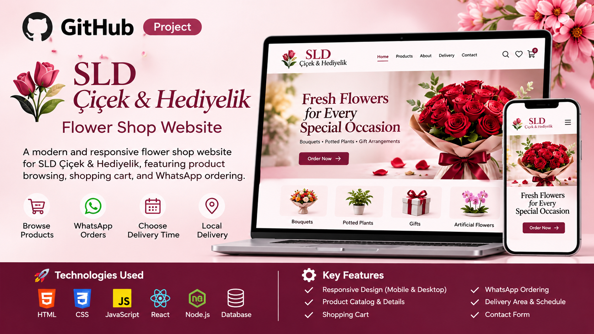

# 🌸 SLD Çiçek & Hediyelik – Flower Shop Website

<p align="center">
  A modern, elegant, and responsive e-commerce website developed for **SLD Çiçek & Hediyelik**, a flower and gift shop based in Istanbul, Türkiye.
</p>

## 🌷 About the Project

SLD Çiçek & Hediyelik is a web development project designed to bring the beauty of flowers and personalized gifts into the online shopping experience.

The website allows customers to explore flower arrangements, discover gift collections, view product details, and contact the shop easily through WhatsApp.

The main goal is to provide customers with a smooth, attractive, and user-friendly shopping experience on both desktop and mobile devices.

## ✨ Key Features

- 🌹 **Product Catalog:** Browse flowers, bouquets, plants, and gifts.
- 🛍️ **Shopping Cart:** Add and manage selected products.
- 📱 **Responsive Design:** Optimized for desktop, tablet, and mobile.
- 💬 **WhatsApp Integration:** Contact the shop and place orders directly.
- 🚚 **Local Delivery:** Delivery service in selected areas of Istanbul.
- 📅 **Delivery Scheduling:** Choose a preferred delivery date and time.
- 📩 **Contact Page:** Easy communication with the shop.
- 🎁 **Special Arrangements:** Personalized flower and gift options.

## 🛠️ Technologies Used

- Next.js
- React.js
- TypeScript
- JavaScript
- CSS
- Node.js
- HTML

## 📸 Project Preview

The website features a clean and elegant design inspired by flowers, nature, and modern online shopping.

## 🚀 Getting Started

To run the project locally:

1. Clone the repository:

   ```bash
   git clone https://github.com/krkralkair007/sld-cicek-hediyelik-website.git
   ```

2. Open the project folder:

   ```bash
   cd sld-cicek-hediyelik-website
   ```

3. Install dependencies:

   ```bash
   npm install
   ```

4. Start the development server:

   ```bash
   npm run dev
   ```

5. Open your browser and visit:

   `http://localhost:3000`

## 📍 Business Information


- Location: Avcılar, Istanbul, Türkiye
- Instagram: [@sld_cicek_hediyelik](https://www.instagram.com/sld_cicek_hediyelik/)
- Website: [sldçiçekhediyelik.com](https://sldçiçekhediyelik.com/)

## 🎯 Project Purpose

This project demonstrates practical web development skills, including responsive interface design, product management, shopping cart functionality, and customer communication integration.

## 👨‍💻 Developer

**ALKHAIR MAKEEN AHMED**

Software Engineering Student | Full-Stack Developer

---

<p align="center">
  🌸 Designed and developed with care for SLD Çiçek & Hediyelik.
</p>
## Çalıştırma
    npm install
    npm run dev      # http://localhost:3000

## Fotoğraflar
Gerçek ürün fotoğraflarını `public/products/` içine `lib/data.ts` dosyasındaki adlarla koyun
(örn. `jut-duvar-dekoru.jpg`). Dosya yoksa altın SLD yer tutucusu görünür. Logo için `components/Logo.tsx`.

## Yayınlama (Vercel)
GitHub'a yükleyin → vercel.com'da "Import Project" → Deploy. `lib/data.ts` içindeki `SITE.url` değerini
gerçek alan adınızla değiştirin.

## Sonraki adımlar
Ödeme: iyzico/PayTR için `lib/payment.ts`. Admin: `app/admin` + veritabanı. Fiyatlar örnektir.
